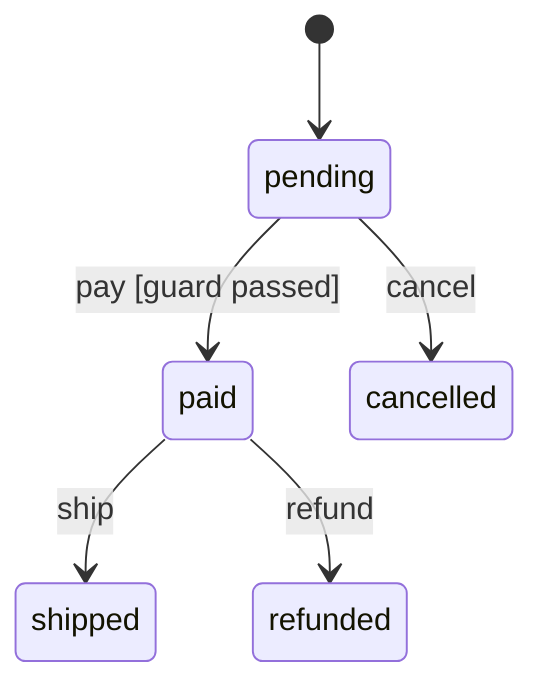

# Laravel State Machine

[](LICENSE)
[](https://www.php.net/)
[](https://laravel.com/)

Declarative finite state machine for Laravel domain workflows (orders, auctions, bookings) with transition guards, lifecycle hooks, and immutable audit history.

## Key Architectural Highlights

- **Fluent State Graph:** Define valid `from -> to` transitions cleanly in one place.
- **Transition Guards:** Block invalid domain actions dynamically using context-aware predicates.
- **Before & After Hooks:** Trigger notifications, ledger postings, or side-effects around state changes.
- **Audit Trail:** Automatically captures `from`, `to`, `actor`, `context`, and timestamps.

## Architecture & Lifecycle Workflow



## Installation & Setup

```bash
composer require nikhilakhiyaniya/laravel-state-machine
```

Publish the package configuration:

```bash
php artisan vendor:publish --tag="state-machine-config"
```

## Quick Start

```php
use NikhilAkhiyaniya\StateMachine\{StateGraph, StateMachine};

$graph = (new StateGraph())
    ->allow('pay', 'pending', 'paid')
    ->allow('ship', 'paid', 'shipped')
    ->guard('ship', fn ($from, $to, $ctx) => !empty($ctx['tracking_number']));

$fsm = new StateMachine($graph, 'pending');
$fsm->apply('pay', actor: 'customer:19');
```

## Testing

```bash
composer test
```

## Security & Contributing

If you discover a security vulnerability, please email `nikhilakhiyaniya@gmail.com` instead of using the public issue tracker. Pull requests with unit tests are welcome.

## License

The MIT License (MIT). Please see [LICENSE](LICENSE) for more information.
